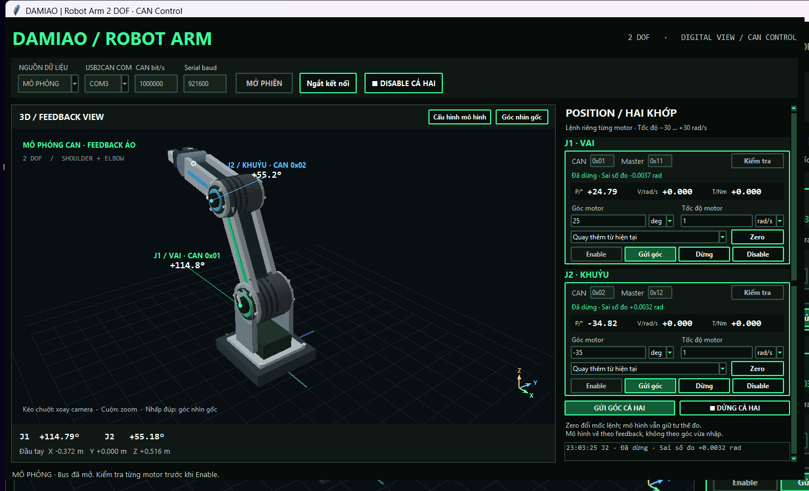
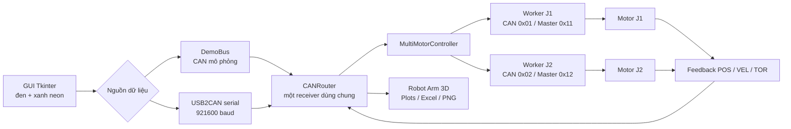
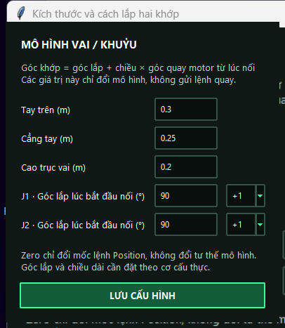

# DAMIAO Multi-Axis Arm Controller

Phần mềm điều khiển hai actuator DAMIAO DM4310 V3 độc lập trên cùng bus CAN, có giao diện Position/Manual Jog, đồ thị feedback và mô hình cánh tay robot 2 DOF theo thời gian thực.



> Ảnh được chụp bằng CAN mô phỏng. Khi chọn **CAN THẬT**, tư thế 3D chỉ cập nhật từ feedback nhận được của motor, không chạy theo góc vừa nhập.

## Tổng quan hệ thống



Mỗi motor có worker, trạng thái Enable, zero phần mềm, mục tiêu và timeout riêng. Lỗi hoặc Disable một trục không làm dừng trục còn lại. `CANRouter` là nơi duy nhất đọc bus và phân phối frame theo Master ID.

## Chức năng chính

- Điều khiển riêng theo CAN ID trên một adapter USB2CAN.
- Xác minh CAN ID, Master ID, firmware, mode, PMAX, VMAX, TMAX và XOUT trước khi cho phép Enable.
- Position tương đối từ vị trí hiện tại hoặc tuyệt đối từ zero phần mềm.
- Góc nhiều vòng: 360° quay một vòng, 720° quay hai vòng.
- Manual Jog liên tục trong khoảng `-30…+30 rad/s` hoặc giới hạn VMAX của driver.
- Đổi đơn vị `deg`/`rad` và `rad/s`/`rpm` mà vẫn giữ giá trị vật lý.
- Theo dõi vị trí nhiều vòng qua vùng wrap của feedback.
- Đồ thị POS / VEL / TOR riêng từng motor, không dừng thu dữ liệu khi đổi tab.
- Xuất snapshot feedback thành PNG và Excel có timestamp Asia/Saigon.
- Mô hình robot vai–khuỷu 2 DOF có camera xoay, zoom, cấu hình kích thước, góc lắp và chiều motor.
- Chế độ DemoBus để thử toàn bộ GUI mà không mở cổng CAN thật.

## Cấu hình motor hiện tại

| Khớp | CAN ID | Master ID | Firmware | Driver mode | CAN bitrate |
| --- | --- | --- | --- | --- | --- |
| J1 – Vai | `0x01` | `0x11` | `5017.005` | MIT | 1 Mbps |
| J2 – Khuỷu | `0x02` | `0x12` | `5017.005` | MIT | 1 Mbps |

## Cài đặt và chạy

```powershell
cd F:\Damiao_Control\motor_controller
python -m pip install -r requirements.txt
```

Mở giao diện robot 2 DOF:

```powershell
python run_robot_arm_2dof.py
```

Trong giao diện, chọn **MÔ PHỎNG** để thử không có phần cứng hoặc **CAN THẬT** để mở USB2CAN. Có thể mở thẳng chế độ mô phỏng bằng:

```powershell
python run_robot_arm_2dof.py --demo
```

Mở giao diện điều khiển/đồ thị hai motor:

```powershell
python run_multi_motor.py
```

## Luồng vận hành với motor thật

1. Đóng DAMIAO Debugging Tool và các chương trình đang giữ cổng COM.
2. Chọn **CAN THẬT**, đúng COM USB2CAN, CAN `1000000 bit/s`, serial `921600 baud`.
3. Mở phiên và chờ từng motor xác minh cấu hình cùng feedback XOUT.
4. Nhấn Enable riêng từng motor. Giao diện chỉ báo Enabled sau khi driver phản hồi status `1`.
5. Thử góc nhỏ và tốc độ thấp, xác nhận chiều J1/J2 trước khi tăng biên độ.
6. Dùng **Dừng** để đưa tốc độ lệnh về 0 nhưng giữ Enable; dùng **Disable** để bỏ mô-men chủ động.

Mở bus hoặc Enable không tự gửi góc đích. Mất feedback, fault driver hoặc overspeed sẽ dừng trục tương ứng. Phần mềm không biết giới hạn cơ khí thực tế, vì vậy cần giới hạn chuyển động và bố trí dừng khẩn cấp ở hệ thống vật lý.

## Cấu hình mô hình 3D



Góc hiển thị được ánh xạ từ feedback nhiều vòng:

```text
q1 = góc_lắp_J1 + chiều_J1 × (feedback_J1 − feedback_J1_lúc_kết_nối)
q2 = góc_lắp_J2 + chiều_J2 × (feedback_J2 − feedback_J2_lúc_kết_nối)
góc cẳng tay so với đế = q1 + q2
```

Zero Position chỉ đổi mốc lệnh, không làm mô hình nhảy tư thế. Các kích thước mặc định là minh họa và cần hiệu chỉnh theo cơ cấu thật.

## Cấu trúc repository

```text
Damiao_Control/
├── README.md
└── motor_controller/
    ├── run_multi_motor.py
    ├── run_robot_arm_2dof.py
    ├── single_motor/          # codec DAMIAO và USB2CAN serial
    ├── multi_motor/           # router, worker, GUI, plots, export
    ├── robot_arm_2dof/        # GUI robot, động học, renderer 3D, DemoBus
    ├── docs/images/           # ảnh giao diện dùng trong tài liệu
    └── tests/                 # kiểm thử protocol, controller và GUI
```

## Kiểm thử

```powershell
cd F:\Damiao_Control\motor_controller
python -m unittest discover -s tests -v
```

Bộ test mô phỏng bao phủ codec CAN, router hai motor, Enable/Disable, Position nhiều vòng, Manual Jog, timeout/fault, telemetry, export, động học 2 DOF và vòng đời GUI. Kiểm thử mô phỏng không thay thế việc xác nhận trên motor thật.

Tài liệu chi tiết nằm tại [motor_controller/README.md](motor_controller/README.md), [multi_motor/README.md](motor_controller/multi_motor/README.md) và [robot_arm_2dof/README.md](motor_controller/robot_arm_2dof/README.md).
