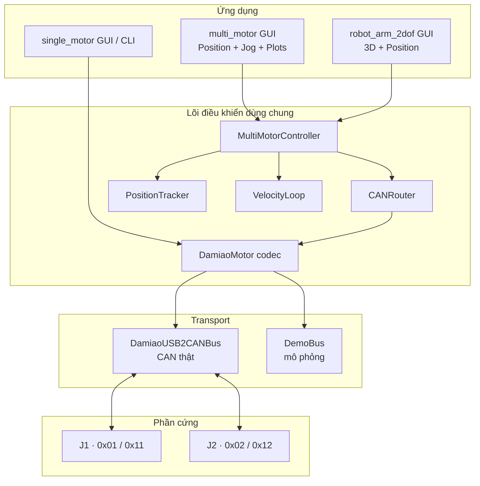

# DAMIAO Motor Controller

Bộ điều khiển Python cho hai motor DM4310 V3 firmware `5017.005`, dùng chung một adapter USB2CAN. Thư mục này chứa ba lớp ứng dụng: điều khiển một motor, điều khiển nhiều motor và giao diện robot arm 2 DOF.


Ảnh trên sử dụng `DemoBus`; nhãn **MÔ PHỎNG CAN · FEEDBACK ẢO** luôn hiển thị khi không dùng phần cứng thật. Ở chế độ **CAN THẬT**, mô hình chỉ đổi tư thế sau khi nhận feedback mới từ đúng Master ID.

## Kiến trúc



`CANRouter` sở hữu receiver duy nhất cho bus. Mỗi `MotorSession` có worker nối tiếp riêng để lệnh của J1 và J2 không chặn nhau. Feedback được tích lũy thành vị trí nhiều vòng rồi đưa tới bảng số, đồ thị và mô hình 3D.

## Cài đặt

Khuyến nghị Python 3.12:

```powershell
cd F:\Damiao_Control\motor_controller
python -m venv .venv
.\.venv\Scripts\Activate.ps1
python -m pip install -r requirements.txt
```

Các biến cấu hình trong `.env`:

```dotenv
DAMIAO_CAN_CHANNEL=COM3
DAMIAO_CAN_BITRATE=1000000
DAMIAO_CAN_SERIAL_BAUDRATE=921600
DAMIAO_MULTI_COMMAND_RATE_HZ=100
```

## Chạy ứng dụng

Robot arm 2 DOF:

```powershell
python run_robot_arm_2dof.py
```

Robot arm với CAN mô phỏng:

```powershell
python run_robot_arm_2dof.py --demo
```

Điều khiển hai motor và xem đồ thị:

```powershell
python run_multi_motor.py
```

Điều khiển một motor:

```powershell
python -m single_motor.gui
```

## Motor và giao thức

| Motor | CAN ID lệnh | Master ID feedback | Firmware | Mode | PMAX / VMAX / TMAX |
| --- | --- | --- | --- | --- | --- |
| J1 | `0x01` | `0x11` | `5017.005` | MIT | Đọc trực tiếp từ driver |
| J2 | `0x02` | `0x12` | `5017.005` | MIT | Đọc trực tiếp từ driver |

- CAN bitrate mặc định: `1 Mbps`.
- Serial baud USB2CAN mặc định: `921600`.
- CAN ID và Master ID phải riêng biệt; CAN ID được giới hạn `0x01..0x0F` theo nibble định danh trong feedback hiện tại.
- Feedback position 16-bit và velocity/torque 12-bit dùng offset-binary unsigned.
- Verify đọc register cấu hình và đối chiếu feedback position với XOUT (`0x51`) trước khi mở Enable.

## Điều khiển Position

- **Quay thêm từ hiện tại** là mặc định: 90° quay thêm 90°, 360° một vòng, 720° hai vòng.
- **Tới góc từ zero** dùng tọa độ theo zero phần mềm của đúng motor.
- Tốc độ nhận `±min(30, VMAX) rad/s` hoặc giá trị rpm tương đương; độ lớn đặt tốc độ Position, dấu góc xác định hướng tới đích.
- MIT Position dùng sai số vị trí đo được và lệnh velocity/Kd, giữ `Kp=0` để tránh kéo về tọa độ raw đã wrap.
- Khi tới hoặc cắt qua đích, controller chốt velocity 0 và chờ ba mẫu vận tốc gần 0.
- Stop giữ driver Enabled với lệnh tốc độ 0; Disable loại bỏ mô-men chủ động.

## Manual Jog

Nhập tốc độ có dấu trong khoảng `-30…+30 rad/s` hoặc VMAX nhỏ hơn. Một lần nhấn sẽ chạy liên tục cho đến khi Stop, Disable, đổi mode, disconnect hoặc mất feedback. Đổi tab hay thả chuột không dừng Jog.

## Robot Arm 2 DOF

Mô hình vai–khuỷu nằm trong `robot_arm_2dof/`. Bên trái là renderer 3D Tk Canvas; bên phải là Position độc lập cho J1/J2. Kéo chuột để orbit camera, cuộn để zoom và nhấp đúp để trả về góc nhìn gốc. Camera không phát frame CAN.


Cửa sổ cấu hình cho phép chỉnh chiều dài tay trên/cẳng tay, cao vai, góc lắp ban đầu và dấu chiều quay. File cục bộ `robot_arm_2dof/local_config.json` không được commit. Đây là mô hình động học; chưa mô phỏng trọng lực, tải, va chạm, backlash hay giới hạn cơ khí.

## Feedback, đồ thị và export

Tab đồ thị trong `multi_motor` hiển thị POS / VEL / TOR riêng từng CAN ID. Lịch sử được giữ khi đổi tab hoặc tạm dừng hiển thị. Snapshot được lưu dưới `motor_feedback/`:

- PNG gồm ba đồ thị thời gian.
- Excel gồm bảng Measurements, công thức quy đổi, sai số velocity và native charts.
- Tên file chứa CAN ID cùng ngày/giờ Asia/Saigon và không ghi đè lần lưu trước.

## Trạng thái và an toàn

Enable chỉ thành công khi driver phản hồi status `1 (Enabled)`. Mở bus, Verify hoặc xoay camera không Enable motor và không gửi mục tiêu chuyển động. Feedback quá hạn được hiển thị `—`; fault, mất feedback hoặc overspeed dừng riêng trục bị ảnh hưởng.

Khi làm việc với phần cứng thật:

1. Chọn **CAN THẬT**, đúng COM, CAN bitrate và serial baud.
2. Verify riêng cả hai motor.
3. Enable từng motor và kiểm tra status/RX trước khi gửi góc.
4. Thử chuyển động nhỏ, tốc độ thấp và xác nhận chiều lắp.
5. Chuẩn bị giới hạn cơ khí và dừng khẩn cấp độc lập với phần mềm.

## Cấu trúc mã nguồn

| File/thư mục | Trách nhiệm |
| --- | --- |
| `single_motor/damiao_v12.py` | Codec CAN, register, Enable/Disable và feedback. |
| `single_motor/usb2can_serial.py` | Framing USB2CAN vendor qua serial. |
| `multi_motor/can_router.py` | Định tuyến một bus tới nhiều motor. |
| `multi_motor/controller.py` | Worker và state machine độc lập từng trục. |
| `multi_motor/position_tracker.py` | Vị trí nhiều vòng qua rollover. |
| `multi_motor/velocity_loop.py` | Bù nhỏ sai số tốc độ có chống windup. |
| `multi_motor/plots.py` | Telemetry lịch sử và đồ thị Tk. |
| `multi_motor/export_feedback.py` | Snapshot PNG/XLSX. |
| `robot_arm_2dof/gui.py` | GUI, nguồn dữ liệu và ánh xạ feedback vào khớp. |
| `robot_arm_2dof/scene.py` | Mesh 3D, camera, projection và shading. |
| `robot_arm_2dof/kinematics.py` | Động học 2 DOF, đơn vị và validation. |
| `robot_arm_2dof/demo_bus.py` | Motor/CAN mô phỏng không mở COM thật. |

## Kiểm thử

```powershell
python -m unittest discover -s tests -v
```

Các test bao phủ protocol, routing hai motor, Enable trung tính, Position/Jog, vị trí nhiều vòng, timeout/fault, biểu đồ/export, động học và GUI mô phỏng. Việc kiểm thử với motor thật vẫn cần thực hiện sau mỗi thay đổi liên quan đến transport, wiring hoặc tham số điều khiển.

Xem thêm [multi_motor/README.md](multi_motor/README.md), [robot_arm_2dof/README.md](robot_arm_2dof/README.md) và [WEEKLY_REPORT_W41.md](WEEKLY_REPORT_W41.md).
